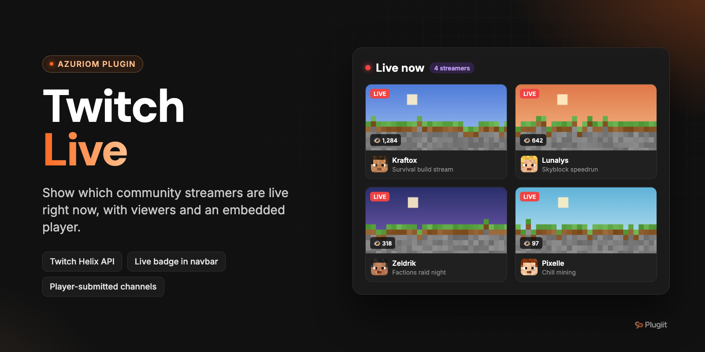

# Plugiit Twitch Live

Show which of your community's streamers are live on Twitch, with an embedded player, a theme widget and a live counter in the navbar.

Azuriom plugin · v1.0.0 · by Plugiit

## Features

- **Live streams page** at `/plugiit-twitch-live`: one card per stream with thumbnail, title, viewer count, stream duration, game and linked website member.
- **Featured streamer**: the Twitch player of the featured streamer currently live is embedded at the top of the page (`player.twitch.tv`, with `parent=` set to the current domain).
- **Offline streamers** listed below the live streams.
- **"Live now" widget** to include in any theme view.
- **Optional live counter in the navbar**, added next to every navbar link pointing to the live page (and on its parent dropdown toggle). It only reads the cache and never calls Twitch.
- **Channel declaration by players** from their profile ("My Twitch channel" card). An administrator approves or rejects each declared channel.
- **Filters**: only Minecraft streams and/or a required keyword in the stream title (case insensitive).
- **Resilient**: on a network or API error, the page keeps working and shows the last known state with a warning. The error is logged and visible in the admin panel, and a new attempt is made after one minute.
- **Demo mode** (disabled by default) that simulates streams from the streamers list without calling Twitch, clearly flagged in the admin panel and on the public page.
- **Encrypted credentials**: the Twitch Client ID and Client Secret are stored encrypted in the database.
- Action log entries for streamers (created, updated, deleted) and settings changes.
- English and French translations.

## Requirements

- Azuriom `1.1.0` or later (`azuriom_api` 1.1.0).
- A **Twitch application** (Client ID and Client Secret) created on the [Twitch developer console](https://dev.twitch.tv/console/apps).
- Outbound HTTPS access from your web server to `id.twitch.tv` and `api.twitch.tv`.
- Recommended: the Laravel scheduler cron, so streams are refreshed in the background:

  ```
  * * * * * cd /path/to/azuriom && php artisan schedule:run >> /dev/null 2>&1
  ```

  Without the cron, streams are refreshed on demand during visits, at most once per cache duration.

## Installation

**From the Azuriom Market** (recommended): install and enable the plugin from **Admin → Plugins**.

**Manually**:

1. Copy the plugin into the `plugins/` directory of your Azuriom installation. The folder **must be named after the plugin ID**, not after the repository:

   ```
   plugins/plugiit-twitch-live/
   ```

2. Enable the plugin from **Admin → Plugins**. The migrations create the `plugiit_twitch_live_streamers` table.

Then:

1. Create an application on <https://dev.twitch.tv/console/apps> (category "Website Integration", OAuth redirect URL `http://localhost`) and generate a secret.
2. Enter the Client ID and Client Secret in **Admin → Twitch Live → Settings**.
3. Add your streamers in **Admin → Twitch Live → Streamers**.
4. Add the page to your navbar: **Admin → Navbar**, type "Plugin", route "Live streamers".

## Configuration

### Permission

| Permission | Description |
| --- | --- |
| `plugiit-twitch-live.admin` | Manage Twitch streamers |

### Streamers

**Admin → Twitch Live → Streamers** (`/admin/plugiit-twitch-live/streamers`):

| Field | Description |
| --- | --- |
| Twitch login | The name in the `twitch.tv/<name>` address (4 to 25 letters, digits or `_`). Must be unique. |
| Linked website member | Exact username of an Azuriom member (optional). |
| Featured | Featured streamers are listed first and their Twitch player is embedded on the page. |
| Status | Approved, pending or rejected. Only approved streamers are displayed. |

Channels declared by players appear in a separate "Channels declared by players" list, with **Approve** and **Reject** buttons. The streamers list also shows which channels are currently live.

### Settings

**Admin → Twitch Live → Settings** (`/admin/plugiit-twitch-live/settings`):

| Setting | Default | Description |
| --- | --- | --- |
| Client ID / Client Secret | none | Twitch application credentials, stored encrypted. Leave the secret empty to keep the saved one. |
| Only Minecraft streams | Off | Keep only streams whose game is Minecraft. |
| Required keyword in the title | none | Keep only streams whose title contains this keyword. |
| Cache duration | 3 minutes | Between 1 and 60 minutes. Maximum frequency of the Twitch API calls. |
| Navbar live counter | On | Show the number of live streams next to the "Live streamers" navbar link. |
| Player channel declarations | On | Allow players to declare their channel from their profile. |
| Demo mode | Off | Simulate streams without calling Twitch. Disable it in production. |

The settings page also shows the current status (number of live streams, last update, last error) and a **Refresh now** button.

## Usage

### Public pages

| Page | URL |
| --- | --- |
| Live streams | `/plugiit-twitch-live` |
| Declare / update a channel (logged-in players) | `POST /plugiit-twitch-live/channel` |
| Remove the declared channel (logged-in players) | `DELETE /plugiit-twitch-live/channel` |

The channel routes are used by the profile card and are rate-limited (10 requests per minute).

### Theme widget

```blade
@include('plugiit-twitch-live::widget')
@include('plugiit-twitch-live::widget', ['limit' => 3, 'hideWhenEmpty' => true])
```

| Parameter | Default | Description |
| --- | --- | --- |
| `limit` | `5` | Maximum number of streams listed. |
| `hideWhenEmpty` | `false` | Render nothing when nobody is live. |

### Artisan command

```sh
php artisan plugiit-twitch-live:refresh          # refresh only if the cache has expired
php artisan plugiit-twitch-live:refresh --force  # refresh now
```

This command is registered in the Laravel scheduler (every minute, without overlapping). It only calls Twitch when the cache has expired.

## How the Twitch integration works

- App access token obtained with the client credentials flow (`POST https://id.twitch.tv/oauth2/token`), cached until it expires (minus 5 minutes) and renewed automatically if Twitch answers `401`.
- `GET /helix/streams?user_login=…` in batches of 100 logins.
- `GET /helix/users?login=…` for display names and avatars, cached for 24 hours and stored on the streamers.

## Development

PHPUnit tests for the Helix client (`Http::fake()`: response parsing, batches of 100, token caching and renewal, errors):

```sh
vendor/bin/phpunit plugins/plugiit-twitch-live/tests
```

## Support

Open an issue on GitHub or contact Plugiit.

## Contributing

Issues and pull requests are welcome.

## License

License: to be defined.
